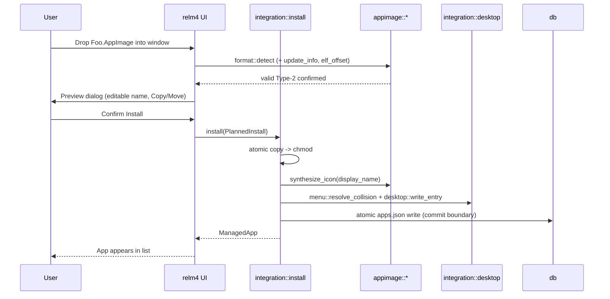

# Cratey architecture

## Module map

```
src/
  main.rs            CLI entry (GUI or --bin-import); assert_not_root guard
  lib.rs             re-exports; assert_not_root
  error.rs           AppError enum + Result alias (defaulted error param)
  model.rs           domain types: ManagedApp, AppId, Settings, providers
  paths.rs           XDG locations (data_dir, applications_dir, icons_dir, lock)
  db.rs              atomic JSON persistence (apps.json) + flock (`Db`)
  appimage/
    mod.rs           orchestrator + synthetic-ELF test util
    format.rs        magic-based Type-2 detection; Type-1 rejected
    elf_offset.rs    squashfs offset via goblin ELF section / hsqs scan
    icon.rs          synthesized 256×256 PNG (image crate, inline bitmap font)
    scan.rs          walkdir for `*.AppImage` (no symlink follow)
    update_info.rs   embedded `.zsync:` trailer parser (Phase 1 read-only)
  integration/
    mod.rs           PlannedInstall
    desktop.rs       .desktop templating + write + update-desktop-database
    menu.rs          collision resolution (Write / Adopt / Refuse)
    install.rs       atomic install with stratified rollback
    launch.rs        shell-free spawn
  update/
    mod.rs           UpdateProvider trait + UpdateOutcome / NewRelease
    github.rs        GitHub Releases fetch + asset selection
    manual.rs        manual HTTPS URL provider
    zsync.rs         Phase-2 stub ("not implemented")
    apply.rs         shared download+verify+atomic-swap pipeline
  ui/
    app.rs           relm4 SimpleComponent (imperative widgets)
```

## Data flow



## ID stability

`AppId` (`crate_<ulid>`) is set once at install and never changes. The
`.desktop` basename is a pure function of the id (`crate-<last8>.desktop`), so
renames never rename the menu entry and two same-name apps never collide.

|Action|id|display_name|desktop basename|installed_path|
|---|---|---|---|---|
|install|set|preview|derived|plan|
|rename|fixed|updated|fixed|fixed|
|update|fixed|fixed|fixed|replaced atomically|
|uninstall|removed|–|–|removed|

## Update-provider contract

```rust
pub trait UpdateProvider {
    fn check(&self, app: &ManagedApp) -> Result<UpdateOutcome>;
    fn apply(&self, app: &mut ManagedApp, new: NewRelease) -> Result<()>;
}
enum UpdateOutcome { NoUpdate, Available(NewRelease), Failed(String) }
```

`apply` (shared in `update/apply.rs`): HEAD size probe (rejects unknown or
>2 GiB before streaming) → download to tempdir → verify sha256 → validate
AppImage → move old binary to `<installed>.prev` → rename new into place (roll
back on failure) → re-chmod → atomic DB write. The `.desktop` and icon are
never regenerated because the binary path is unchanged.

## Persistence

One JSON document, `${XDG_DATA_HOME}/cratey/apps.json`, written atomically
(tmp + rename) under an exclusive `flock` (`.lock`). A second `cratey` process
exits with "another instance is running".

## v1 constraints

- AppImages are never executed, mounted, or unpacked; no `squashfs-tools`
  prerequisite.
- Icons are always synthesized (`image` crate); embedded `.DirIcon`
  extraction is Phase 2.
- Network is opt-in (manual / on-demand update checks only).
- Refuses to run as root.